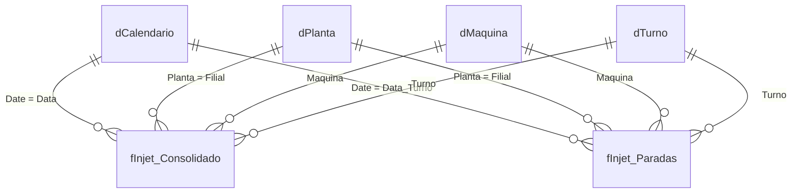

# Modelo de dados

Modelo semântico do Power BI em esquema estrela, 100% Import, sem relacionamento bidirecional e sem caminho circular. No projeto original ele é mantido em formato PBIP/TMDL, versionado como código.



## Tabelas

| Tabela | Tipo | Grão | Observação |
|---|---|---|---|
| `fInjet_Consolidado` | fato | data x turno x planta x máquina x molde | tempos (trabalhado, parado, teórico), cavidades e peças. Base do OEE |
| `fInjet_Paradas` | fato | data x turno x máquina x motivo | duração e eventos apontados pelo operador. Base do Pareto, MTBF e MTTR |
| `dCalendario` | dimensão | dia | tabela calculada, marcada como tabela de datas |
| `dMaquina` | dimensão ponte | máquina | `DISTINCT(UNION(...))` das duas fatos |
| `dTurno` | dimensão ponte | turno | ordem de exibição lida do rótulo ("1º Turno" -> 1) |
| `dPlanta` | dimensão | planta | |
| `dCascata` | desconectada | etapa | eixo do gráfico de cascata de perdas (B -> A1 -> ritmo -> cavidade -> refugo -> F) |
| `MEDIDAS_OEE` | medidas | - | medidas em `dax/medidas-oee.dax` |

## Por que as dimensões ponte

No modelo original, `Maquina` e `Turno` eram texto solto em cada fato, sem relacionamento. Um filtro de máquina no Pareto de paradas não alcançava o OEE, e a comparação de turnos não cruzava parada e produção. As tabelas `dMaquina` e `dTurno` resolvem isso sem bidirecional:

```dax
dMaquina =
DISTINCT (
    UNION (
        SELECTCOLUMNS ( fInjet_Consolidado, "Maquina", fInjet_Consolidado[Maquina] ),
        SELECTCOLUMNS ( fInjet_Paradas, "Maquina", fInjet_Paradas[Maquina] )
    )
)
```

## Guarda de esquema no Power Query

As duas plantas vêm de bancos diferentes e são unidas com `Table.Combine`, que aceita colunas diferentes e preenche com nulo em silêncio. Para isso não virar número errado no relatório, a consulta compara as colunas antes de unir e falha na atualização se divergirem:

```powerquery
ColsA = List.Sort(Table.ColumnNames(fInjet_PlantaA)),
ColsB = List.Sort(Table.ColumnNames(fInjet_PlantaB)),
Combinada = Table.Combine({fInjet_PlantaA, fInjet_PlantaB}),
Resultado =
    if ColsA <> ColsB then
        error Error.Record(
            "Esquemas divergentes",
            "As plantas têm colunas diferentes.",
            "Só na A: " & Text.Combine(List.Difference(ColsA, ColsB), ", ")
                & " | Só na B: " & Text.Combine(List.Difference(ColsB, ColsA), ", ")
        )
    else
        Combinada
```
